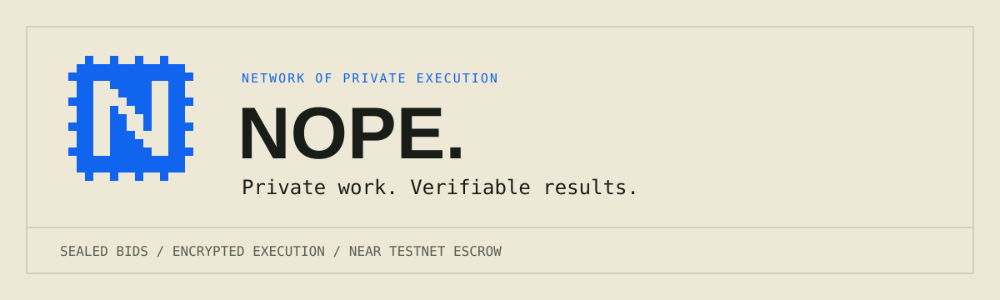

# NOPE — Network of Private Execution

Run private multi-field invoice/cash-flow rules, or hire an agent for bounded CSV cleaning, without exposing private rows to the planning model or service provider. NOPE combines sealed price bids, encrypted execution, independently verifiable result proofs and customer-funded escrow on NEAR.

**NEAR Hackathon 2026 · Privacy & Private AI · Working testnet prototype**

[Open NOPE](https://nope-workspace.vercel.app) · [Enter the application](https://nope-workspace.vercel.app/workspace) · [User documentation / Türkçe dahil 5 dil](https://nope-workspace.vercel.app/docs) · [Verify a completed job](https://nope-workspace.vercel.app/verify?id=c77599347652ecdfb2362a620afa5e99)

The canonical URL is [nope-workspace.vercel.app](https://nope-workspace.vercel.app). Browser vault data is origin-specific: a fresh wallet login can recover wallet-owned job access, but cannot recover a CSV, decoder or witness stored on a different origin. Existing sessions should keep their original tab until that work is complete.

## Independent code review

Start with the current `/workspace` path. This is the shortest route from each claim to its implementation and negative tests:

| Check | Implementation | Regression evidence |
| --- | --- | --- |
| Private rows excluded from planner input | `web/agent-model-worker.mjs`, `web/agent-plan.mjs` | `planner-runtime/boundary.test.mjs`, `web/agent-plan.test.mjs` |
| Sealed bid release and buyer/provider permissions | `workspace/core.mjs`, `web/workspace-vault.mjs` | `workspace/workspace.test.mjs`, `workspace/wallet-core.test.mjs` |
| Wallet origin, nonce, account and callback binding | `workspace/wallet-auth.mjs`, `api/workspace.mjs` | `workspace/wallet-auth.test.mjs`, `workspace/origin.test.mjs` |
| Precommitted result statement and rejection of changed labels, amount or revision | `web/proof-plan-core.mjs`, `web/proof-plan-client.mjs` | `tests/proof_plan.test.mjs`, `tests/public_proof.test.mjs`, `tests/wallet-public-proof.test.mjs` |
| Exact escrow liabilities, transfer failure and refund authorization | `payments/wallet_escrow/src/lib.rs`, `workspace/wallet-escrow.mjs` | `payments/wallet_escrow/src/tests.rs`, `workspace/wallet-escrow.test.mjs` |

Run the offline regression/build commands below first. No private wallet keys, customer CSVs, project Blob token or live transaction are needed for those checks. Use the public completed-job verifier for independent hosted proof/chain checks. A fresh full self-hosted marketplace needs your own storage credential; a static file server alone cannot run the API. Historical proof/evaluation experiments and the old Python `sdk/` receipt adapter are not the current application’s autonomous-agent SDK.

## What you can try

A customer describes a bounded cleaning task using anonymous column names, approves a locally generated plan, and receives bids encrypted to their browser. The customer selects a provider and signs an exact-amount escrow deposit from their own wallet. The provider initiates computation on the encrypted task. The customer checks the output, produces a result proof and explicitly accepts the delivery before signing payment release.

This repository's current application is `/workspace`. The older Concrete FHE/MPC and sponsor-funded demonstrations remain separate historical experiments; they are not the implementation of the current browser flow.

## Judge walkthrough

### 1. Independently verify an existing result — no wallet or installation

Open [this browser-demo job](https://nope-workspace.vercel.app/verify?id=c77599347652ecdfb2362a620afa5e99). The page fetches public encrypted evidence, checks the pinned contract and finalized chain state, then verifies the actual Noir/UltraHonk result proof in your browser. Wait for the explicit success message and `escrowState: Paid` in the details.

No customer session, CSV, decoder or private mapping is needed. This three-row/two-column browser demo has six actual result proofs. The [earlier one-row HTTP run](docs/verification/wallet-funded-http-production.json) used an authored plan and does not demonstrate neural planning.

### 2. Try the customer/provider application

Use a current desktop Chromium browser, two different funded NEAR **testnet** accounts, and separate browser profiles for the customer and provider. The shipped wallet selector currently supports **Intear Wallet**. End users do not install a Python companion or a browser extension for NOPE itself.

1. Open the workspace, choose Customer, and connect your testnet wallet. Sign the account-verification message. Never enter a wallet private key into NOPE.
2. Create a job and select a synthetic CSV, for example:

   ```csv
   record,score,note
   A,,keep
   B,200,preserve
   C,42,unchanged
   ```

3. Set `score` / `C2` to Number and leave the other columns unselected. Use the public goal: `Fill C2 blanks with 7 and clamp C2 to 0..100.` The local planner should propose supported operations; review them rather than assuming the model interpreted your goal correctly. For that approved plan, the local preview is `7, 100, 42`, while the other fields remain unchanged.
4. Approve the plan and preview, then encrypt and publish. The optional budget is a private local note, not an enforced spending limit; review the selected price before signing. Do not include confidential data in the public title, description or goal.
5. In the provider profile, choose Provider, connect a different testnet wallet, open the job and submit an encrypted price bid. For this walkthrough use **0.001 testNEAR**. Other providers cannot decrypt it.
6. The customer closes bidding, decrypts the bids locally and selects a provider. The selected provider and price now become public. Review the service price, non-refundable **0.04096 testNEAR** storage charge and total, then approve the exact deposit in the customer wallet; execution stays blocked until funding is finalized.
7. The selected provider opens Delivery, initiates the encrypted calculation and signs delivery recording for its exact version and output hash.
8. The customer reviews the in-app before/after result, generates the proof, waits for verification and explicitly accepts that delivery. Then the customer signs payment release. Wait for the finalized provider transfer; a wallet's send response alone is not payment evidence.

The first planner use downloads approximately **412.5 MB** of pinned public model files and caches them in the browser. Inference runs locally with Qwen3-0.6B through Transformers.js/ONNX Runtime. Proof generation and verification also load public WASM/SRS assets and can take time. Loading, unsupported operations and failed verification do not silently switch to plaintext processing.

**Verified live demo:** [C775](docs/verification/c775-full-browser-lifecycle.json) completed the production Chrome/Intear flow: wallet authentication, sealed bidding, encrypted execution, six verified result proofs, explicit buyer acceptance and **FINAL 0.001 testNEAR provider payout**. A fresh unauthenticated process and the live public browser verifier checked all six proofs and the `Paid` chain binding; independent receipt checks verified the exact native transfer and successful nonce-bound callback. Refund-popup signing remains untested; direct-chain refund checks passed separately.

## How the system works

| Component | Responsibility | Relevant implementation |
| --- | --- | --- |
| Customer browser and encrypted vault | CSV parsing, private mappings, bid keys, encryption, local preview/decryption and proof witness | [Browser workspace](web/workspace.js), [vault](web/workspace-vault.mjs) |
| Local planning model | Converts a public goal and anonymous typed columns into an allowlisted plan; receives no private rows | [Planner worker](web/agent-model-worker.mjs), [pinned model](planner-runtime/model-pack.json) |
| Marketplace API and private storage | Wallet-verified sessions, sealed bids, immutable job revisions, exact signing intents and read-only chain observation | [Backend documentation](workspace/README.md), [API](api/workspace.mjs) |
| Encrypted evaluator | Evaluates one-use garbled circuits using selected wire labels; returns output labels without the decoder | [Execution dispatch](workspace/gc.mjs), [GC protocol](web/gc-core.mjs) |
| Result proof | Noir/UltraHonk proofs of typed transformations under precommitted buyer mappings; independent browser/server verification | [Proof runtime](proof-runtime/README.md), [public verifier](web/public-proof.mjs) |
| NEAR escrow | Holds the exact customer deposit per job, binds terms/delivery, and transfers to the selected provider or refunds the original buyer | [Contract and protocol](payments/wallet_escrow/README.md) |

The provider currently triggers the server-side evaluator; this is not an independent provider-node network. Sealed bidding uses browser encryption and customer selection, not a distributed MPC auction. No arbitrary agent-supplied executable code is accepted.

## What stays private, and what is public

| Data | Visibility in the implemented flow |
| --- | --- |
| Original CSV, filename, original column names and untouched fields | Customer device; not sent to the planning model or marketplace API |
| Public goal, title, description, anonymous column types and approved plan | Public job metadata; the customer must not put secrets here |
| Bid price before selection | Encrypted for the customer; the customer opens bids after closing intake; the server enforces that release order |
| Losing bids | Not decrypted by competing providers; the customer can read them |
| Selected provider, selected price, wallet accounts, deadlines and transaction hashes | Public when committed/funded on NEAR |
| Task labels, encrypted tables, commitments and result-proof records | Available to authorized execution roles; public verification exposes the bounded encrypted evidence/proof |
| Wallet signing key | Remains with the wallet; NOPE receives signatures and public account information |

Sealed bids do not cryptographically force the customer to choose the lowest price. Browser encryption does not hide data from the customer's own browser, a compromised client, or malicious code delivered by a compromised frontend. The customer initially sees and encrypts the plaintext; the evaluator and planner receive different restricted inputs.

## Customer-funded NEAR escrow

- Network: **NEAR testnet**.
- Immutable shared contract: **`nope-wallet-5144c7d4.testnet`**.
- Pinned code hash: **`349qhEttcFqG3ezvPHBCoFCyM8X1ZpXzYotgfqFXgN13`**.
- Contract access keys were removed and the FINAL empty key list was independently checked. There is no application admin withdrawal/upgrade method.
- The shared contract keeps an independent liability for each `(buyer account, job ID)`. Customer deposits do not finance other jobs. Its separately bootstrapped storage/gas reserve is not a sponsor payment pool.
- Contract-level Ed25519 admission binds an exact selected job, parties, price and deadlines. The server admission key cannot accept, refund or withdraw; it is separate from all wallet keys. Direct unsigned funding cannot consume shared slots. This is application admission, not Sybil resistance; prepaid per-job storage removes the shared free-capacity dependency.
- The buyer signs `fund`; the provider or buyer can record exact delivery metadata; only the original buyer signs `accept_and_release` or an eligible `refund`.
- Execution is allowed for 24 hours from award; the review/refund boundary is 48 hours from award. Acceptance/release must be within the review window; refund is available strictly after it, subject to final contract state. Refund is a wallet action, not an automatic timer payment.
- The service price is **1 yoctoNEAR–1 testNEAR**. Funding attaches that price plus **0.04096 testNEAR** for the permanent job record; this storage charge is **not refunded**. Payout or an eligible refund transfers the service price only. Network transaction fees are additional. Each job prepays its own bounded storage in an independently keyed `LookupMap`; there is **no shared permanent 50-job capacity**. The UI separates service price, storage charge and total before signing.
- Unknown submission outcomes are observed without automatic signing or rebroadcast. Transfers use nonce/action-bound callbacks; failed transfers restore liabilities and other jobs remain protected.
- Legacy direct-transfer, sponsor and retired-wallet jobs are historical read-only records. The completed C775 run keeps its original contract binding; the public verifier retains its pinned historical policy. Before cutover, a FINAL inventory confirmed zero outstanding liabilities or pending transfers on that old contract. [Migration evidence](payments/wallet_escrow/verification/admission-v1/legacy-before-cutover.json).

No mainnet deployment, real-money payment support or automatic dispute arbitration is claimed. The contract records the commitments and delivery and enforces payment authorization; it **does not execute the SNARK verifier on-chain**.

## Exactly what the proof establishes

For supported typed transformations, a result SNARK verifies that the delivered labels represent the approved transformation's result relative to the buyer's precommitted mappings. The private witness stays on the customer device. Browser and API independently verify the current proof; the public verifier additionally checks the pinned contract and finalized chain binding through a trusted RPC.

This does **not** prove original CSV provenance, honest initial garbling/mapping, the provider's physical execution trace, AES execution provenance, the LLM's understanding of the customer's intent, or an independent operator quorum. The frontend, API authorization and RPC remain trust boundaries. Cryptographic result correctness is separate from customer acceptance and the native payment receipt.

## Supported work and resource limits

### Multi-field private rules — v5

The new record engine computes across private fields rather than processing each column independently. A public, allowlisted straight-line plan accepts **1–8 unsigned 32-bit fields**, **1–8 instructions**, up to four public constants and **1–4 derived outputs**. Arithmetic, comparisons and conditional selection operate on encrypted wire labels. Original names, Unicode notes and unselected columns remain local; they are not silently interpreted by the numeric engine.

- **Invoice audit:** quantity × unit price → expected amount; positive excess billing; billed amount ≤ private budget; exact-match flag. Example `[3,12500,40000,50000]` produces `[37500,2500,1,0]` without sending those four values to the evaluator.
- **Cash-flow checks:** combine income, expenses, existing debt, proposed payment, credit limit and requested amount; return disposable funds, remaining payment capacity and separate limit/cash-flow flags. These are explicitly programmed checks, not a credit recommendation or an AI prediction.
- `addSat` / `subSat` saturate at the unsigned 32-bit bounds. `mul16` is exact but requires both operands ≤65,535. Values are canonical nonnegative integers; monetary fields use **minor currency units**, never floating-point arithmetic. Missing, negative, decimal or out-of-domain values are refused before publication.
- The reviewed invoice template currently fits **five records**; cash-flow fits **eleven**. Other plans have their own preflight budget, bounded by 16 records, **10,000 total gates** and less than **3 MiB** with the protocol envelope reserve. No truncation or plaintext fallback.
- Each record has a genuine Noir/UltraHonk result proof under a **separate pinned v5 circuit/policy**, preserving historical v4 proofs. The record circuit has 95,436 measured gates (131,072 dyadic size) and uses the existing pinned public SRS.
- These two reviewed templates are deterministic programs. The separate existing local-AI cleaner still performs real neural planning; selecting a rule template is not presented as model inference. An external agent may construct the bounded public DSL, subject to exact validation and customer approval.

### Local-AI cleaner — v4

- Numbers: missing-value fill and clamp; blank or integer `0..254`, with `255` reserved for missing values.
- Text: trim, lowercase/uppercase and digit masking for printable ASCII, at most **16 bytes per cell**.
- At most **4 selected columns**, **32 numeric rows**, **8 rows when text is processed**, and **40 processed cells**; circuit/request-size limits also apply.
- Unselected columns are preserved locally. The small local model can misunderstand/refuse a goal. Missing selected columns reject the whole proposal; approval is not a theorem that the model understood natural language.

**Not implemented:** arbitrary PDF understanding, semantic document reasoning, translation, summarization, general sorting/deduplication, or general-purpose encrypted LLM inference. The new structured rule engine does not remove the honest-garbler, frontend or RPC trust assumptions explained above.

### Try the invoice task

Choose **multi-field encrypted rules → invoice audit** in the new-job screen. Map `quantity`, `unit_cents`, `billed_cents`, `budget_cents` in that order, review the preview and approve it. The provider bids, executes and records delivery through the same marketplace; the buyer opens the result table, proves the current delivery and accepts before wallet release.

```csv
quantity,unit_cents,billed_cents,budget_cents,private_note
3,12500,40000,50000,synthetic-private-note
```

The local note is preserved unchanged. The four appended results are `37500,2500,1,0`; those clear results remain on the buyer's device. Synthetic examples in this README are public illustrations, not customer data.

## Reproduce the checks and build

Prerequisites: **Node.js 22.22.2 or newer** (recorded local verification used 25.6.0), npm, and Python 3.9+ for packaging the historical companion download during the web build. Rust/native FHE/MPC tooling is not required to run the current JavaScript regression suite or web build.

```sh
git clone https://github.com/Foreveranka/nope.git
cd nope
npm ci
npm ci --prefix planner-runtime --ignore-scripts
npm ci --prefix proof-runtime --ignore-scripts
npm ci --prefix wallet-runtime --ignore-scripts
npm run check:locales
npm test
npm run build
```

The post-remediation root suite passed **507 tests, zero failures and zero skips** in **95.245 seconds** on 14 November 2026. The application build and all five locale catalogs also passed. [Current release checks](docs/verification/public-release-checks.json) record scope and the completed hosted HTTP deployment check; the earlier 494/492-test snapshots remain historical. Tests include genuine local cryptography and explicitly synthetic transport/RPC fixtures; they do not broadcast transactions. The build packages the wallet/planner/proof runtimes and generates `dist/`; it neither deploys nor downloads the planner's model weights.

Additional proof checks:

```sh
node proof-runtime/prepare-crs.mjs
npm run test:proof
```

The first command verifies the checked-in public SRS bytes/hashes offline. The second packages and exercises the proof runtime; its tests are separate from the recorded 494-test root suite.

### Rebuild the escrow contract separately

For the Rust contract, use the **Rust 1.98.0** toolchain used by the recorded build (the crate declares a 1.95 minimum). From the repository root:

```sh
rustup toolchain install 1.98.0 --profile minimal
rustup target add wasm32-unknown-unknown --toolchain 1.98.0
cargo +1.98.0 test --locked --lib --manifest-path payments/wallet_escrow/Cargo.toml
cargo +1.98.0 build --locked --release --target wasm32-unknown-unknown --manifest-path payments/wallet_escrow/Cargo.toml
```

These commands run contract unit tests/builds, not deployment or wallet operations. They may fetch the locked Rust dependencies. The contract README also records the exact cached local sandbox procedure used for its evidence; that machine-specific cache is not included in a fresh clone. The checked-in deployed WASM and its source/hash manifest are the release reference; a different compiler build is not automatically a reviewed or bit-identical deployment.

### Run your own full application

The hosted demo is the quickest review path. To self-host the complete application, use a Vercel-compatible Node environment and **your own private Vercel Blob store**. Set `BLOB_READ_WRITE_TOKEN` only in the server environment and `NOPE_WORKSPACE_ORIGIN` to the exact origin visitors use. `NOPE_WORKSPACE_COMPAT_ORIGINS` optionally lists additional exact origins, separated by commas; it grants no cross-origin API or signature access. The source defaults allow the canonical NOPE URL and the old URL only. Explicit self-host origins do not inherit those defaults. Project keys, invitations and existing Blob credentials are not included in the repository.

For local development, after installing Vercel CLI (58.7.1 was used for the recorded checks) and supplying your own private Blob credential in ignored local environment configuration:

```sh
NOPE_WORKSPACE_ORIGIN=http://127.0.0.1:3000 vercel dev --local --listen 127.0.0.1:3000
```

Open `http://127.0.0.1:3000`. A plain static file server cannot provide `/api/workspace` or wallet authentication. The server/browser contract pins must match; builds and payment observation fail closed on mismatches. Neither wallet private keys nor customer plaintext belong in server configuration.

The reviewed live deployment is immutable and capacity-limited. See the contract protocol and provisioning scripts before deploying a separate testnet instance; deployment is an explicit action, never part of `npm test` or `npm run build`. The provisioning and wallet-HTTP QA scripts can create test accounts or sign testnet transactions when explicitly invoked. Do not treat them as read-only smoke commands or run them against a real wallet by copying someone else's recovery files.

## Evidence: implemented, tested and still limited

| Check | Evidence | Meaning |
| --- | --- | --- |
| Root regression | [Release checks](docs/verification/wallet-release-checks.json) | Historical 494/492 snapshots; [post-remediation checks](docs/verification/public-release-checks.json) record 507 passing cases with crypto and synthetic adapters separated |
| Completed browser lifecycle | [C775 snapshot](docs/verification/c775-full-browser-lifecycle.json) | Six proofs, explicit acceptance, FINAL exact 0.001 testNEAR payout, successful callback and Paid hold; all 11 independent checks pass |
| Browser funding flow | [C775 fund-only evidence](docs/verification/c775-fund-only.json) | Exact 0.001 testNEAR, FINAL same-block pinned code/empty key list and Held state; no payment or result-proof claim |
| Browser delivery recording | [C775 record-only evidence](docs/verification/c775-record-only.json) | Exact selected-provider record call, zero deposit, FINAL Delivered v1/output hash; no payment or result-proof claim |
| Real deployed HTTP lifecycle | [Production run](docs/verification/wallet-funded-http-production.json) | Genuine test-wallet NEP-413, sealed bid, exact buyer deposit, encrypted execution, actual result proof, explicit acceptance and provider payout |
| Independent public result verification | [C775 verifier](https://nope-workspace.vercel.app/verify?id=c77599347652ecdfb2362a620afa5e99) | All six proofs and Paid binding passed in live Chrome and a fresh unauthenticated process without the buyer witness |
| Actual native payout and refund | [V2 financial checks](payments/wallet_escrow/verification/storage-v2/live-financial-checks.json) | Exact public-testnet provider payment and original-buyer refund; direct contract tests, not computation proofs |
| Locked deployment | [V2 code/key check](payments/wallet_escrow/verification/storage-v2/deployment-public.json) | Finalized code, source-WASM hash and empty access-key list |
| Contract execution/failure cases | [Contract evidence](payments/wallet_escrow/README.md#actual-validation-and-deployment) | 18 current contract unit tests and a real keyless WASM sandbox; local sandbox is not public-chain evidence |
| Wallet UI | [Wallet runtime](wallet-runtime/README.md) | Real Intear authentication, fund, record and release popup flows checked; refund popup remains untested |

Full chain transaction hashes and proof-scope qualifications are in the [completed browser lifecycle snapshot](docs/verification/c775-full-browser-lifecycle.json). No screenshot, mocked receipt, hash-only transcript or successful outer transaction is labelled a computation proof or final payout by itself.

## Security review and release boundaries

The pre-public review identified and addressed three availability paths: direct unauthorised consumption of contract slots, anonymous consumption of a shared session allowance, and provider refreshes consuming customer revisions. The admission service is not Sybil-proof; independently keyed records prepay their storage instead of consuming a fixed shared allowance. A separate clock regression fixes intermittent NEP-413 challenge rejection. See the [release security notes](docs/RELEASE-SECURITY.md), source and executable regressions; this is not an exhaustive third-party audit or a guarantee of security.

The recorded C775 browser/video run predates the V2 storage charge and keeps its original proof/contract binding. New jobs show the separate retained-storage charge before funding. The [V2 maximum-price HTTP run](docs/verification/wallet-funded-http-local-storage-v2-price-max.json) independently verifies the new total and payout on real testnet; it uses a local HTTP server and authored plan, not the production browser/model.

The [current hosted HTTP run](docs/verification/wallet-funded-http-production-production-v2-1411.json) also completed against **nope-workspace.vercel.app** with real NEP-413, a **0.04196 testNEAR** deposit (0.001 service +0.04096 storage), actual result proof, explicit acceptance and FINAL **0.001 testNEAR** payout. It uses synthetic input and an authored plan; it is not a new wallet-popup or neural-planning test. Actual Chrome also verified its result proof, Paid state and separate storage/total binding without local private data. [Verify this V2 job](https://nope-workspace.vercel.app/verify?id=665b2a8ba7d720ff25c170ea724bfa3d).

## Languages

The product, job creation, bidding, delivery, payment screens and documentation support **Turkish, English, German, Spanish and French**. The initial language uses the country header provided by Vercel: TR → Turkish, DE → German, ES → Spanish, FR → French, otherwise English. A manual selection is remembered; customer values are not sent to a translation service. [Localization details](docs/LOCALIZATION.md).

## Repository map and prior work

- `web/`: current frontend, planner/proof clients and public verifier.
- `workspace/`, `api/workspace.mjs`: current application API, authentication, private storage and chain observation.
- `payments/wallet_escrow/`: current Rust escrow contract, protocol, frozen WASM and financial evidence.
- `wallet-runtime/`, `planner-runtime/`, `proof-runtime/`: pinned browser/runtime integration and checks.
- `docs/verification/wallet-*`: current wallet-funded integration evidence.
- `engine/`, `mpc/`, `cloud/`, `service/`, `contracts/registry/`, `payments/testnet_escrow/` and older routes: earlier FHE, MPC, cloud and payment experiments. Their evidence remains scoped to those historical runs; they are not independent production operators or the current customer-funded contract.

Historical evidence retains the original deployment identifiers and signed commitments. These records are not rewritten during a brand or domain migration. [Archived prototype notes](docs/archive/LEGACY-PROTOTYPES.md) preserve the previous README's historical material. The current architecture is the six-component flow above; the shipped browser evaluator uses garbled circuits, not Concrete FHE or a distributed MPC auction.

Libraries, templates, AI assistance, model weights, fonts and upstream wallet code are attributed in [third-party notices](THIRD_PARTY_NOTICES.md). AI coding/planning assistance does not replace the stated tests or prove untested features. This repository contains both the historical prototypes and the current work; this README separates their scope instead of counting old evidence as current validation.

## License

Original NOPE code and documentation are licensed under the [MIT License](LICENSE). Third-party dependencies, model weights, fonts and vendored upstream code retain their own licenses/terms; the project license does not relicense them. See [third-party notices](THIRD_PARTY_NOTICES.md).

Private keys, seeds, local vaults, `.env*`, invitations, recovery journals and `runtime/` are excluded from Git and the allowlisted deployment. Source updates on `main` trigger the NOPE Vercel deployment. A hackathon submission or social post is a separate action.


## Multi-field v5 verification

[Record engine and proof specification](docs/RECORD-RULES.md) documents the exact DSL, arithmetic domains, label/proof boundaries and version dispatch. `web/record-core.test.mjs`, `web/record-proof.test.mjs` and `workspace/record-workspace.test.mjs` exercise actual garbling/evaluation, genuine proof generation and negative cases, and the API lifecycle with explicitly simulated escrow transport.

The [local-HTTP v5 invoice run](docs/verification/wallet-funded-http-local-record-invoice-v5-local.json) used real testnet wallet authentication, a sealed bid, buyer-funded V2 escrow, encrypted multi-field evaluation, a genuine record proof, explicit acceptance and **FINAL 0.001 testNEAR provider payout**. Its fresh unauthenticated verifier independently checked the proof and pinned Paid state. This is an authored template on a local HTTP API, not a production browser or neural-planning test.

The [hosted v5 invoice run](docs/verification/wallet-funded-http-production-record-invoice-v5-production.json) completed the same multi-field workflow against the canonical production API: genuine test-wallet NEP-413, sealed bidding, encrypted evaluation, record SNARK, explicit acceptance and FINAL payout. This is a synthetic authored-template HTTP test, not neural planning or wallet-popup automation. [Independently verify the current invoice job](https://nope-workspace.vercel.app/verify?id=388ac007d73c3b2f983335dcbb80f158).
